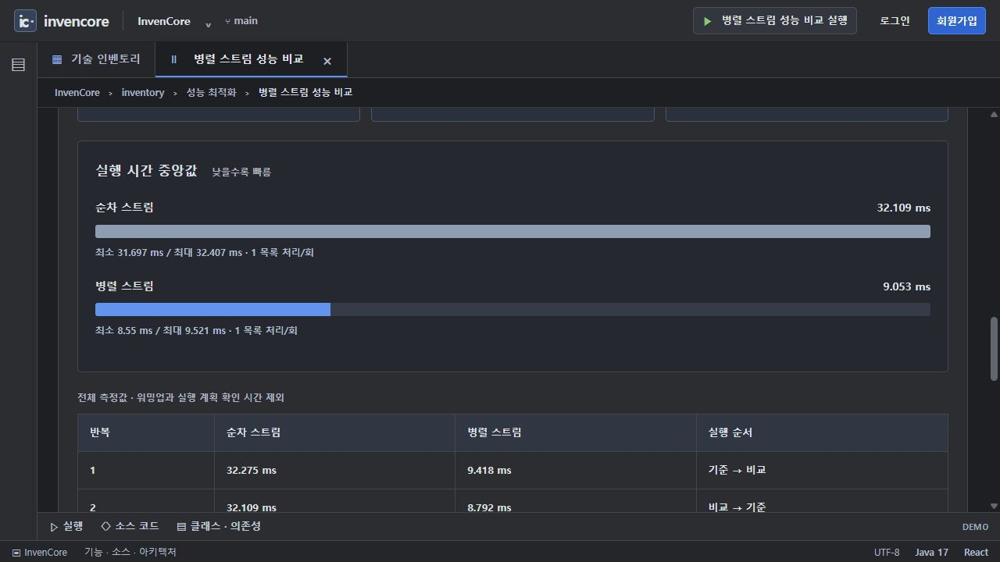
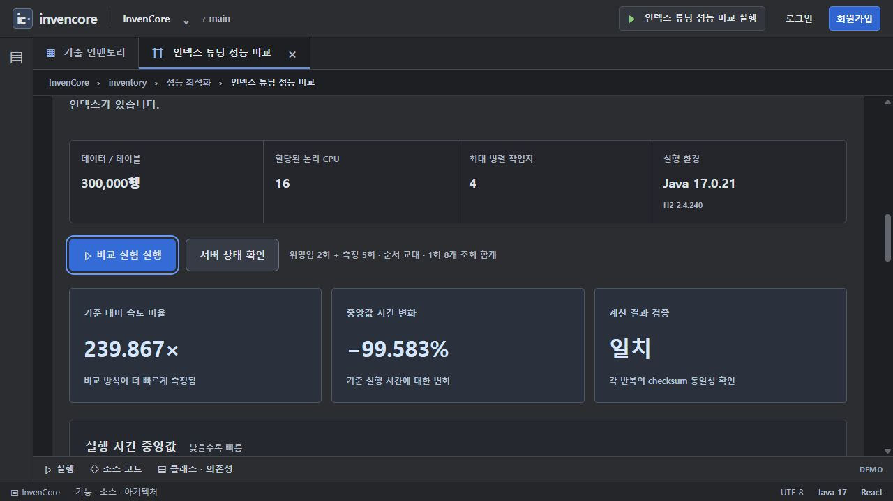
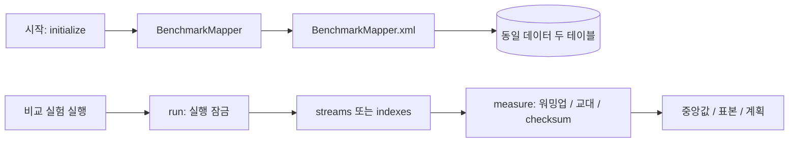

# 성능 비교 · 병렬 스트림 / 복합 인덱스

두 카드 `parallel-stream`, `index-tuning`이 공유하는 패키지입니다. JPA가 아닌 MyBatis Mapper와 XML로 비교용 H2 테이블을 준비하고, 실제 실행 시간을 측정합니다.

[전체 예제·실행 준비·캡처 안내](../../../../../../../../../../docs/EXAMPLES.md) · [Java 실습 안내](../../../../../../../../../../docs/INVENTORY_PRACTICE.md)

> 기준: 2026-11-13. 이미지는 별도 로컬 서버에서 샘플 데이터로 캡처했습니다. 기본 H2 메모리 데이터는 서버 종료 시 사라집니다.

## 실행과 측정 조건

1. 백엔드 시작 시 `BenchmarkDataInitializer`가 테이블당 기본 300,000행을 준비합니다.
2. `/inventory/parallel-stream?tab=demo` 또는 `/inventory/index-tuning?tab=demo`를 엽니다.
3. `DATA READY`를 확인한 뒤 **비교 실험 실행**을 누릅니다.
4. checksum 일치, 중앙값, 5개 표본, 실행 계획을 함께 비교합니다. 고정된 속도 향상 수치를 합격 기준으로 쓰지 않습니다.

워밍업 2회 후 5회 측정하며 기준→비교와 비교→기준 순서를 교대합니다. 서버 프로세스 공용 잠금으로 한 번에 한 실험만 허용합니다. 데이터가 준비 중이면 503, 다른 측정 실행 중이면 409를 반환합니다.

## 병렬 스트림

같은 숫자 목록에 `score`의 64회 CPU 변환을 적용해 합산합니다. 순차 `stream()`과 전용 `ForkJoinPool` 안의 `parallelStream()`을 비교합니다. 최대 작업자는 `min(4, 사용 가능한 CPU 수)`이며 DB 조회·대기 시간은 포함하지 않습니다.



현재 서버에서 측정한 순차·병렬 시간과 반복값. CPU·JIT·GC·부하에 따라 달라집니다.

## 인덱스 튜닝

`bench_plain`과 `bench_indexed`에는 동일한 데이터와 기본키 인덱스가 있습니다. 후자에만 `(account_id, state)` 복합 인덱스를 추가합니다. 같은 조건의 집계 8회가 한 표본이고 `EXPLAIN ANALYZE`에서 계획과 스캔 정보를 확인합니다. MyBatis 2차 캐시는 끄고 1차 캐시 범위는 `STATEMENT`로 제한합니다.



30만 행 두 테이블의 인덱스 유무 비교. H2 메모리 DB 결과이며 운영 디스크 DB 성능을 대표하지 않습니다.

## 처리 흐름



## 주요 소스와 역할

| 소스 | 역할 |
| --- | --- |
| [BenchmarkDataInitializer](BenchmarkDataInitializer.java) | 앱 시작 후 데이터 준비 |
| [BenchmarkController](BenchmarkController.java) | status와 run, 동시 실행 잠금 해제 보장 |
| [BenchmarkService](BenchmarkService.java) | initialize·streams·indexes·measure·time·summarize |
| [BenchmarkMapper](mapper/BenchmarkMapper.java) | 테이블 생성·복제·집계·계획 인터페이스 |
| [BenchmarkMapper.xml](../../../../../../../resources/mappers/benchmark/BenchmarkMapper.xml) | 고정 테이블 분기와 바인딩 SQL |
| [BenchmarkResult](BenchmarkResult.java) | 환경·표본·비교 결과 DTO |
| [BenchmarkPage](../../../../../../../../../../frontend/src/pages/benchmark/BenchmarkPage.jsx) | 두 카드의 공용 결과 화면, 현재 화면에서 최근 8회 표시 |

## API·설정·실습

| API / 설정 | 역할 |
| --- | --- |
| `GET /api/benchmarks` | 준비 여부·행 수·CPU·Java·DB 환경 |
| `POST /api/benchmarks/streams` | 순차·병렬 비교 |
| `POST /api/benchmarks/indexes` | 인덱스 유무 비교 |
| `BENCHMARK_ROWS` | 기본 300000, 허용 1000~1000000 |

브라우저 API는 로그인 없이 호출합니다. 시간 측정은 버튼을 누를 때만 수행하며, 결과를 미리 채우지 않습니다. 이 비교는 JMH 수준의 정밀 벤치마크가 아니고 병렬화나 인덱스가 언제나 더 빠르다고 보장하지 않습니다.

[UserParallelCode.aggregate](../practice/UserParallelCode.java)와 [UserIndexCode.sumSql/indexSql](../practice/UserIndexCode.java)는 독립 실습입니다. 인덱스 과제는 별도 일회용 H2 DB에서 JDBC로 검사하므로 위 Mapper나 실제 비교 데이터를 바꾸지 않습니다.

```powershell

# 저장소 루트에서 실행
.\backend\gradlew.bat -p backend test --tests "*BenchmarkTests"
```

## 사용하는 기술

MyBatis Spring Boot Starter · H2 · Java Stream/ForkJoinPool. 정확한 버전과 의존성 선언은 저장소의 `backend/build.gradle`에서 확인합니다.
