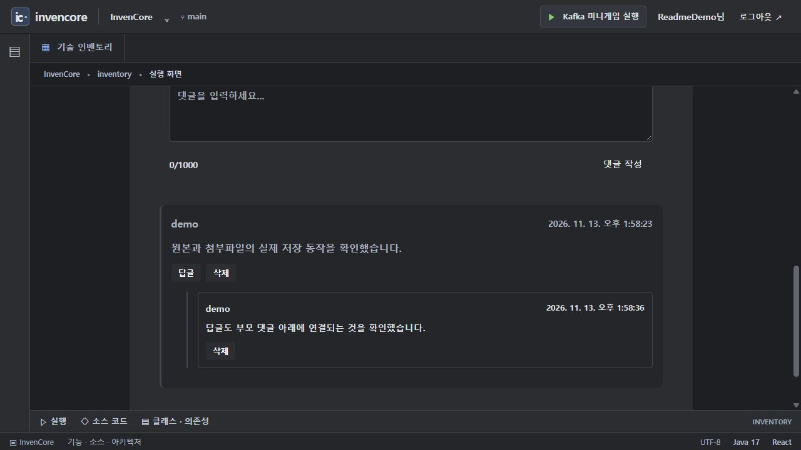
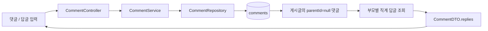

# 댓글과 답글 · 부모 / 직계 답글

카드 `comments`의 백엔드 패키지입니다. `comments` 테이블에서 게시글 번호와 부모 댓글 번호를 사용해 댓글·직계 답글 목록을 구성합니다. 공개 예제이며 작성자는 `demo`입니다.

[전체 예제·실행 준비·캡처 안내](../../../../../../../../../../docs/EXAMPLES.md) · [Java 실습 안내](../../../../../../../../../../docs/INVENTORY_PRACTICE.md)

> 기준: 2026-11-13. 이미지는 별도 로컬 서버에서 샘플 데이터로 캡처했습니다. 기본 H2 메모리 데이터는 서버 종료 시 사라집니다.

## 실행 순서와 이미지

1. 요청 게시판에서 게시글을 하나 만듭니다.
2. 게시글 상세의 댓글 폼에서 부모 댓글을 저장합니다.
3. **답글**을 눌러 부모에 대한 답글을 작성합니다.
4. `/inventory/comments?tab=demo`에서 같은 게시글을 선택해 트리 응답을 확인할 수 있습니다.
5. API는 수정·삭제도 지원하며, 댓글 삭제는 직계 답글을 먼저 지웁니다.



샘플 게시글에서 부모 댓글과 직접 답글을 저장한 실제 화면.

## 처리 흐름과 API



| API | 역할 |
| --- | --- |
| `POST /api/comments` | `{requestBoardId,content,parentId}` 등록. 부모 댓글은 parentId 생략 또는 null |
| `GET /api/comments/requestboard/{id}` | 부모 댓글과 replies 목록 |
| `PUT /api/comments/{id}` | 댓글 내용 수정 |
| `DELETE /api/comments/{id}` | 직계 답글과 해당 댓글 삭제 |

## 주요 소스와 역할

| 소스 | 역할 |
| --- | --- |
| [CommentController](controller/CommentController.java) | 공개 CRUD와 입력 DTO 검증 |
| [CommentService](service/CommentService.java) | 부모 조회 후 replies 조립, 수정·삭제 |
| [CommentRepository](repository/CommentRepository.java) | 게시글·부모별 작성 순서 조회 |
| [Comment](entity/Comment.java) | 게시글 ID·부모 ID·내용·작성 시각 |
| [RequestBoardDetail](../../../../../../../../../../frontend/src/pages/requestboard/RequestBoardDetail.jsx) | 실제 댓글·답글 폼 |
| [CommentDemo](../../../../../../../../../../frontend/src/components/inventory/FeatureDemo.jsx) | 카드 내부의 게시글 선택·댓글 요청 |

## 현재 범위와 실습

현재 응답은 부모와 직계 답글을 표시하며 임의 깊이의 재귀 트리가 아닙니다. 부모별 추가 조회가 발생하므로 많은 부모가 있으면 N+1 조회 비용이 생깁니다. 부모 존재·게시글 일치·소유자 권한의 완전한 검증은 구현되어 있지 않습니다. 게시글 삭제가 이 패키지의 댓글까지 자동으로 정리한다고 가정하면 안 됩니다.

[UserCommentsCode.threads](../practice/UserCommentsCode.java)는 고정 목록에서 게시글 격리·정렬·고아 제외·직계 답글만 선택하는 독립 과제입니다. 그 계약을 완성 서비스의 현재 검증 수준과 혼동하지 마세요.

```powershell

# 저장소 루트에서 실행
.\backend\gradlew.bat -p backend test --tests "*RequestBoardAuthenticationTests"
```

## 사용하는 기술

Spring MVC · Spring Data JPA · Bean Validation · Lombok. 정확한 버전과 의존성 선언은 저장소의 `backend/build.gradle`에서 확인합니다.
