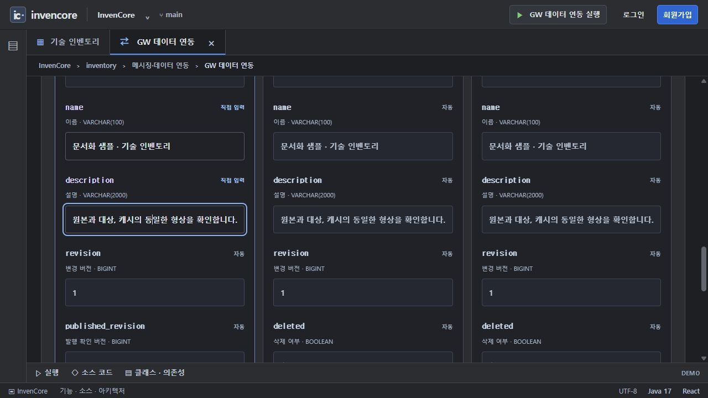
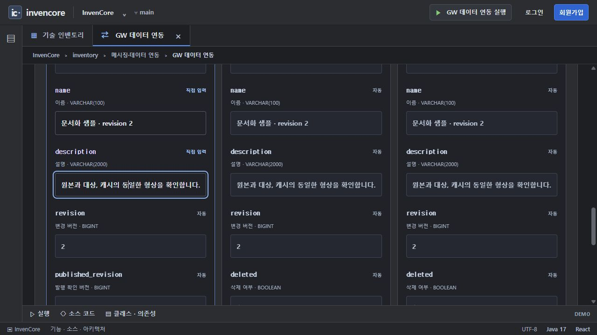
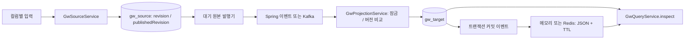

# GW 데이터 연동 · 원본 / 대상 / 형상 캐시

카드 `gw-sync`의 백엔드 패키지입니다. 두 DB 서버가 아니라 기본 H2 DB 안의 `gw_source`와 `gw_target` 두 테이블을 연결합니다. 원본의 최신 상태를 비동기로 전달하고 대상 형상을 캐시에 보관합니다.

[전체 예제·실행 준비·캡처 안내](../../../../../../../../../../docs/EXAMPLES.md) · [Java 실습 안내](../../../../../../../../../../docs/INVENTORY_PRACTICE.md)

> 기준: 2026-11-13. 이미지는 별도 로컬 서버에서 샘플 데이터로 캡처했습니다. 기본 H2 메모리 데이터는 서버 종료 시 사라집니다.

## 실행 순서

1. `/inventory/gw-sync?tab=demo`를 열고 현재 모드가 `LOCAL DEMO`인지 확인합니다.
2. `name`·`description`을 직접 입력하고 **원본 생성 → 변경 이벤트**를 누릅니다.
3. **저장된 두 테이블 버전 일치**가 표시될 때까지 기다립니다. 화면은 2.5초마다 조회합니다.
4. 이름을 수정하고 **원본 수정 → 변경 이벤트**를 누릅니다. 세 형상의 revision 증가를 비교합니다.
5. **삭제 이벤트 전송**을 누르면 행을 즉시 없애는 대신 삭제 표시와 새 revision이 전달됩니다.

## 실제 동작 이미지



왼쪽부터 원본·대상·메모리 캐시입니다. 생성한 name·description과 revision 1이 일치합니다.



수정 후 세 형상의 revision이 2로 증가했습니다. 실제 Kafka·Redis 대신 기본 local 모드로 촬영했습니다.

## 처리 구조



## 주요 소스와 역할

| 소스 | 역할 |
| --- | --- |
| [GwSourceService](service/GwSourceService.java) | create/update/delete와 대기 원본 조회·발행 확인 |
| [GwProjectionService](service/GwProjectionService.java) | 원본 행 잠금, 대상 revision 비교, 스냅샷 이벤트 발행 |
| [GwQueryService](service/GwQueryService.java) | 원본·대상·캐시 조회와 연동 상태 비교 |
| [GwLocalEventPublisher](messaging/GwLocalEventPublisher.java) | local에서 커밋된 대기 원본을 내부 이벤트로 전달 |
| [GwEventPublisher](messaging/GwEventPublisher.java) | external에서 ID key로 Kafka 전송 후 ack 버전 확인 |
| [GwLocalSnapshotCache](cache/GwLocalSnapshotCache.java) | ConcurrentHashMap 원자적 버전 비교와 만료 처리 |
| [GwSnapshotCache](cache/GwSnapshotCache.java) | Redis Lua 버전 비교·JSON·TTL, 장애 시 DB 대체 |
| [GwKafkaConfig](config/GwKafkaConfig.java) | GW 토픽·DLT·재시도 구성 |
| [GwSyncPage](../../../../../../../../../../frontend/src/pages/gwsync/GwSyncPage.jsx) | 컬럼 입력과 상태 폴링 |

## API·설정

| API | 기능 |
| --- | --- |
| `GET /api/gw-sync/status` | 활성 여부, 모드, 전달 방식, 캐시 종류·TTL |
| `GET /api/gw-sync/items` | 최근 원본 20개 |
| `GET /api/gw-sync/items/{id}` | 원본·대상·캐시와 버전 일치 여부 |
| `POST /api/gw-sync/items` | `{name, description}` 원본 생성 |
| `PUT /api/gw-sync/items/{id}` | 이름·설명 변경과 revision 증가 |
| `DELETE /api/gw-sync/items/{id}` | 삭제 표시와 revision 증가 |

| 설정 | 기본값 / 의미 |
| --- | --- |
| `GW_SYNC_ENABLED` | `true` |
| `GW_SYNC_MODE` | `local`; external은 실제 Kafka와 Redis 사용 |
| `KAFKA_BOOTSTRAP_SERVERS` | 외부 모드의 브로커 주소 |
| `REDIS_HOST`, `REDIS_PORT` | 외부 모드의 Redis 주소·포트 |
| `gw-sync.cache-ttl-seconds` | 60초 |
| `gw-sync.publish-delay-ms` | 대기 발행 주기 1초 |

## 버전·장애 처리

원본 변경과 발행 대기는 같은 행의 트랜잭션에 저장합니다. 전송 확인 직후 장애가 나면 중복 발행될 수 있으므로 대상은 최신 revision만 반영합니다. 대상 저장 이후 커밋 이벤트로 캐시를 갱신하고, 캐시에도 버전 역행 방어를 적용합니다. 캐시 저장 실패 시 DB 반영은 유지되며 이전 캐시가 TTL까지 남을 수 있습니다.

이 예제는 최신 상태 연동입니다. 빠르게 여러 번 바뀐 중간 형상이 합쳐질 수 있어 모든 변경 이력을 보존하는 outbox 이벤트 로그와 같지 않습니다. 원본 잠금과 revision은 서로 다른 파티션의 전체 순서를 보장하지 않습니다.

## 직접 구현과 검사

[UserGwCode.shouldApply](../practice/UserGwCode.java)는 독립된 revision 비교 과제입니다. 완성 서비스에 자동 연결하지 않습니다.

```powershell

# 저장소 루트에서 실행
.\backend\gradlew.bat -p backend test --tests "*Gw*Tests"
```

## 사용하는 기술

Spring Data JPA · Spring Kafka · Spring Data Redis · Spring MVC/Validation · Jackson · Lombok. 정확한 버전과 의존성 선언은 저장소의 `backend/build.gradle`에서 확인합니다.
