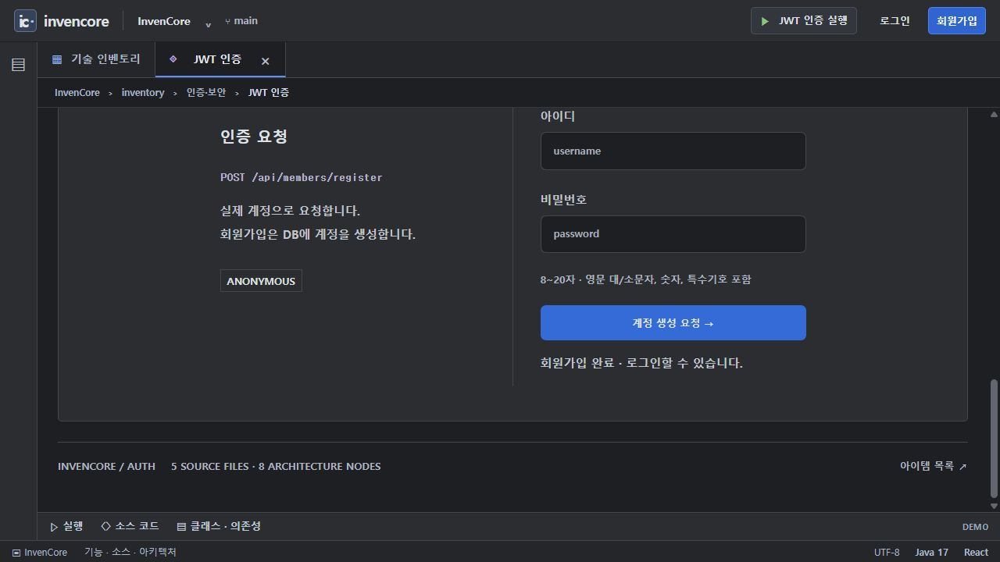
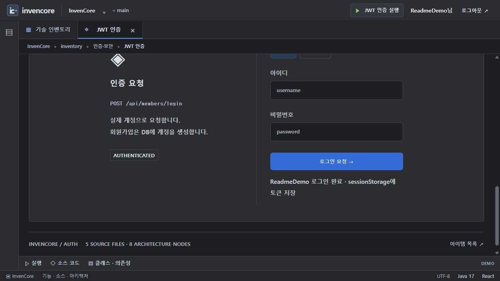
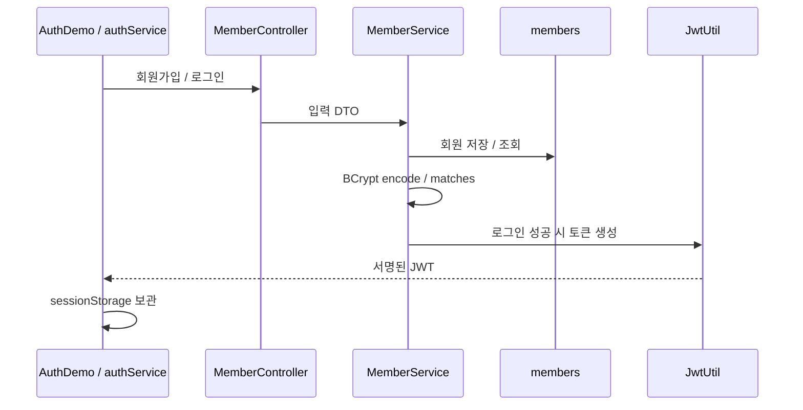

# JWT 인증 · 회원가입 / 로그인

카드 `auth`의 회원 기능 패키지입니다. BCrypt 비밀번호 저장과 JWT 발급을 담당하며, 요청별 인증 필터는 공통 `security` 패키지에 있습니다.

[전체 예제·실행 준비·캡처 안내](../../../../../../../../../../docs/EXAMPLES.md) · [Java 실습 안내](../../../../../../../../../../docs/INVENTORY_PRACTICE.md)

> 기준: 2026-11-13. 이미지는 별도 로컬 서버에서 샘플 데이터로 캡처했습니다. 기본 H2 메모리 데이터는 서버 종료 시 사라집니다.

## 실행 순서

1. `/inventory/auth?tab=demo`에서 **회원가입**을 선택합니다.
2. 영문·숫자 아이디 4~20자와 대·소문자·숫자·특수문자가 포함된 8~20자 비밀번호로 로컬 테스트 계정을 생성합니다.
3. **로그인**으로 전환해 같은 계정으로 요청합니다.
4. `로그인 완료`와 `AUTHENTICATED` 상태를 확인합니다. 캡처에 토큰 원문이나 비밀번호를 표시하지 않습니다.
5. 로그인 팝업·실행 화면은 공통 `authService`를 사용하며, 로그아웃은 브라우저 세션의 인증 정보를 지웁니다.

## 실제 동작 이미지



로컬 샘플 계정의 회원가입 완료 응답. 입력 폼은 제출 후 비워집니다.



같은 샘플 계정으로 로그인한 상태. JWT 원문과 비밀번호는 캡처하지 않았습니다.

## 구조와 API



| API | 기능 |
| --- | --- |
| `POST /api/members/register` | `{username,password}` 회원가입 |
| `POST /api/members/login` | 검증 후 username·role·token·success 응답 |
| `GET /api/members/check-username?username=...` | `isAvailable` 중복 확인 |

## 주요 소스와 역할

| 소스 | 역할 |
| --- | --- |
| [MemberService](service/MemberService.java) | 회원 조회, BCrypt 비교, 가입 시 해시 저장 |
| [Member](entity/Member.java) | members 엔티티와 기본 사용자 역할 |
| [RegisterRequest](dto/RegisterRequest.java) | 가입 입력 검증 |
| [JwtUtil](../../util/JwtUtil.java) | 서명·만료 포함 JWT 발급과 검증 |
| [JwtAuthenticationFilter](../../security/JwtAuthenticationFilter.java) | Bearer 토큰을 검증하고 SecurityContext 설정 |
| [SecurityConfig](../../config/SecurityConfig.java) | 공개·보호 API와 필터 등록 |
| [authService](../../../../../../../../../../frontend/src/services/authService.jsx) | 가입·로그인 요청과 세션 저장 |
| [tokenSession](../../../../../../../../../../frontend/src/services/tokenSession.js) | 클라이언트의 만료 시각 확인 |

## 현재 범위와 실습

테이블은 `members`이며 기본 H2 메모리 DB이므로 재시작하면 계정이 사라집니다. `JWT_SECRET`과 `JWT_EXPIRATION`으로 서명 키와 만료 시간을 설정하며 기본 만료는 30분입니다. 운영 키는 저장소에 기록하지 않습니다.

카드의 가입 폼은 비밀번호를 8~20자로 제한하고, 백엔드 `RegisterRequest`는 8~50자를 허용합니다. 문서의 재현 절차는 양쪽을 만족하는 입력을 사용합니다.

리프레시 토큰·서버 측 로그아웃 토큰 폐기·세밀한 역할 권한은 구현되어 있지 않습니다. 필터는 유효한 인증에 `ROLE_USER`를 부여하며 DB의 숫자 role과 동일한 권한 체계가 아닙니다. 브라우저의 만료 확인은 서명 검증을 대신하지 않습니다. 게시판·댓글·첨부 API는 별도 공개 샘플입니다.

[UserAuthCode.encode/matches](../practice/UserAuthCode.java)는 고정 입력의 BCrypt 과제입니다. 완성 회원 서비스에 자동 적용하지 않습니다.

```powershell

# 저장소 루트에서 실행
.\backend\gradlew.bat -p backend test --tests "*RequestBoardAuthenticationTests"
```

위 테스트는 인증 API의 모든 경우를 포괄하는 전용 회원 테스트가 아니라, 공개 샘플 API의 접근 계약을 확인합니다. 회원가입·로그인 화면 동작은 위 캡처로 별도 확인했습니다.

## 사용하는 기술

Spring Security/BCrypt · JJWT · Spring Data JPA · Spring MVC/Validation · Lombok. 정확한 버전과 의존성 선언은 저장소의 `backend/build.gradle`에서 확인합니다.
