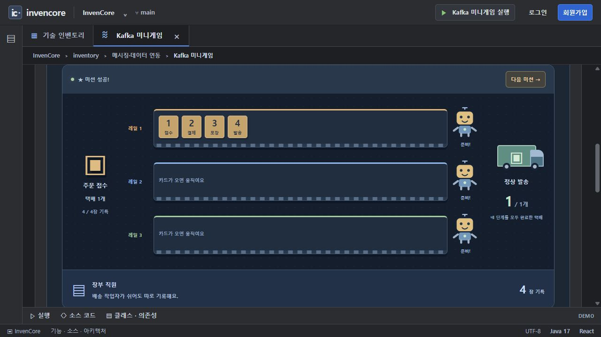
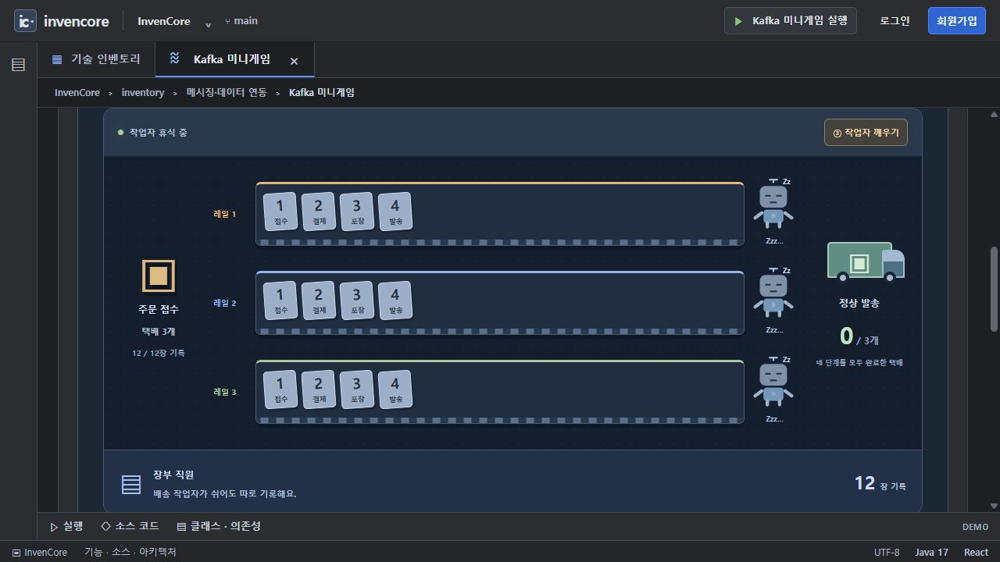
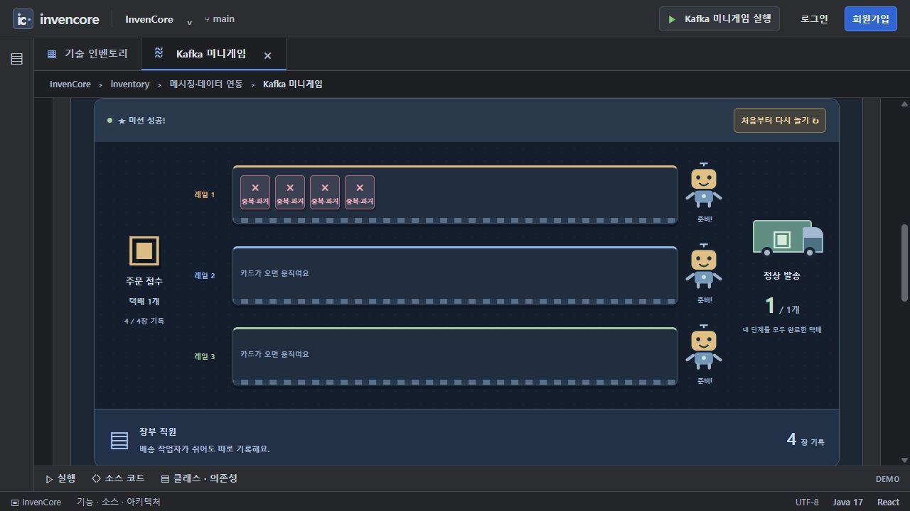
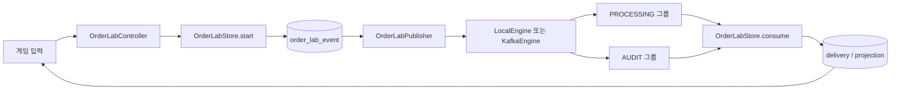

# Kafka 미니게임 · 주문 이벤트 실험실

카드 `kafka-lab`의 백엔드 패키지입니다. 주문 하나를 접수·결제·포장·발송 이벤트로 나누고, 두 소비 그룹의 순서·대기·재처리 결과를 관찰합니다.

[전체 예제·실행 준비·캡처 안내](../../../../../../../../../../docs/EXAMPLES.md) · [Java 실습 안내](../../../../../../../../../../docs/INVENTORY_PRACTICE.md)

> 기준: 2026-11-13. 이미지는 별도 로컬 서버에서 샘플 데이터로 캡처했습니다. 현재 PostgreSQL 데이터는 앱 종료 후에도 유지됩니다. 이 문서의 기존 이미지는 전환 전 H2 환경에서 촬영했습니다.

## 실행과 관찰

1. 기본 설정으로 백엔드와 프론트엔드를 시작하고 `/inventory/kafka-lab?tab=demo`를 엽니다.
2. **완성 예제**에서 미션 01의 **한 레일에 모으기 → 택배 한 개 보내기**를 실행합니다. `1→2→3→4`와 정상 발송 수를 확인합니다.
3. **여러 레일로 나누기**와 비교합니다. 다른 파티션 사이에는 전체 순서 보장이 없습니다.
4. 미션 02에서 **작업자 쉬게 하기 → 택배 세 개 쌓아두기**를 누릅니다. 주문 처리는 멈추고 감사 기록만 늘어나는지 확인한 뒤 **작업자 깨우기**를 누릅니다.
5. 미션 03에서 **택배 한 개 보내기 → 되감기 준비 → 끝낸 작업 다시 읽기**를 실행합니다. 전달 기록은 늘어도 발송 수와 최신 업무 상태는 유지되어야 합니다.
6. **게임 뒤의 기술 보기**를 펼쳐 그룹별 partition·committed offset·lag와 전달 기록을 확인합니다.

## 실제 동작 이미지



같은 레일에서 네 단계 처리 완료. 그림은 서버에 저장된 실제 기록을 느리게 재생한 것입니다.



주문 작업자는 쉬고 감사 그룹만 12장을 기록한 상태. 캡처는 local 모형입니다.



재처리 후 중복·과거 이벤트를 차단한 상태. 캡처는 local 모형입니다.

## 처리 구조



| 저장소 | 내용 |
| --- | --- |
| `order_lab_event` | 발행 전 이벤트와 브로커가 확인한 partition·offset |
| `order_lab_delivery` | 그룹별 수신 위치·처리 결과·작업 스레드·시각 |
| `order_lab_projection` | 소비 그룹별 주문 최신 sequence·상태 |

## 주요 소스와 역할

| 소스 | 역할 |
| --- | --- |
| [OrderLabStore](OrderLabStore.java) | 실행 생성, 주문 행 잠금, projection·전달 기록 저장 |
| [OrderLabPublisher](OrderLabPublisher.java) | 미발행 이벤트 전달 후 위치 확인 |
| [OrderLabLocalEngine](OrderLabLocalEngine.java) | 메모리 위치·커밋과 DB 로그로 동작 원리 재현 |
| [OrderLabKafkaEngine](OrderLabKafkaEngine.java) | 실제 Kafka 발행, Admin 오프셋 조회, 그룹 제어 |
| [OrderLabKafkaConsumer](OrderLabKafkaConsumer.java) | JSON·키 검증, DB 반영 후 커밋, seek 콜백 |
| [OrderLabKafkaConfig](OrderLabKafkaConfig.java) | 두 그룹과 수동 커밋 전용 팩토리 |
| [OrderLabPage](../../../../../../../../../../frontend/src/pages/gwsync/OrderLabPage.jsx) | 2초 주기 상태 조회와 API 요청 |
| [ParcelFactoryGame](../../../../../../../../../../frontend/src/components/inventory/ParcelFactoryGame.jsx) | 세 미션과 실제 기록의 0.42초 간격 재생 |

## API와 주요 메서드

| API | 역할 |
| --- | --- |
| `POST /api/order-lab/runs` | `{routing:"KEYED" 또는 "SPREAD", orders:1..6, implementation:"REFERENCE" 또는 "LEARNER"}`로 실행 생성 |
| `GET /api/order-lab/runs/{id}` | 해당 실행의 발행 수·수신 기록·최종 상태 |
| `GET /api/order-lab/state` | 토픽 전체의 그룹별 파티션 위치·지연 |
| `POST /api/order-lab/groups/{group}/{action}` | `PROCESSING`/`AUDIT`, `pause`/`resume`/`restart`/`replay` |
| `POST /api/order-lab/groups/{group}/replay/{runId}` | 해당 실행의 파티션별 최소 오프셋으로 seek 요청 |
| `GET /api/order-lab/practice` | 학습 TODO의 기본 계약 검사 |

`start`는 주문마다 네 개 이벤트를 저장합니다. `publishOrders`는 확인된 발행 위치를 저장하며 실패한 이벤트는 다음 주기에 다시 시도합니다. `consume`은 주문 잠금과 업무 sequence 비교로 중복·역전을 방어합니다. `replayOffsets`는 발행이 끝난 현재 실행의 최소 위치를 구합니다.

## local과 external의 차이

| 항목 | 기본 `local` | `GW_SYNC_MODE=external` |
| --- | --- | --- |
| 이벤트 전달 | DB 이벤트 로그 + 메모리 체크포인트 | 실제 Kafka 토픽·브로커 |
| 파티션 | 의도적으로 2→1→0 순서로 읽는 모형 | 토픽 3개 파티션, 그룹별 소비자 3개 |
| 커밋/lag | 메모리 값으로 계산 | Kafka Admin API로 조회 |
| 재시작 | 앱 재시작 시 H2·위치 초기화 | 앱의 H2는 여전히 초기화되며 Kafka 보존 위치와 별개 |

external은 GW와 공통 모드를 사용하므로 Kafka·Redis 연결 설정을 함께 준비해야 합니다. 외부 인프라 준비는 루트 README의 GW 설정을 참고합니다. 이 문서의 캡처는 외부 브로커를 실행한 증거가 아닙니다.

순서는 **파티션 내부**에서만 보장됩니다. 오프셋은 업무 sequence가 아니고 파티션 간 비교 기준도 아닙니다. JPA 저장과 Kafka 커밋은 단일 원자적 트랜잭션이 아니므로 재전달 가능성을 가정합니다. 현재 실행 위치로 되감아도 그 뒤에 쌓인 다른 실행 이벤트를 함께 읽을 수 있습니다.

## 직접 구현과 검사

[Kafka TODO 패키지 안내](practice/README.md)의 세 메서드를 작성하고 검사한 다음 **내 Java 코드로 플레이**를 선택합니다. 다른 카드의 독립 과제와 달리 이 모드는 게임 경로에 학습 코드를 적용합니다.

```powershell

# 저장소 루트에서 실행
.\backend\gradlew.bat -p backend test --tests "*OrderLab*Tests"
```

[Kafka 용어 사전](../../../../../../../../../../docs/KAFKA_GLOSSARY.md) · [상세 실습](../../../../../../../../../../docs/KAFKA_PRACTICE.md)

## 사용하는 기술

Spring Kafka · Spring Data JPA · Spring MVC/Validation · Jackson · Lombok. 정확한 버전과 의존성 선언은 저장소의 `backend/build.gradle`에서 확인합니다.
