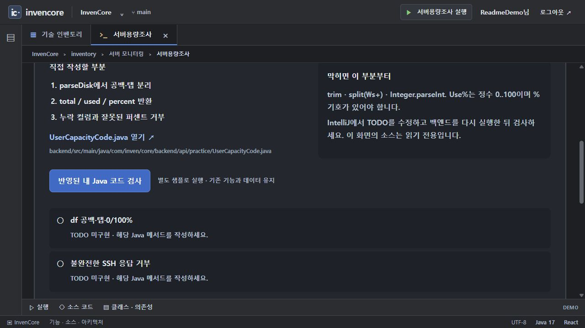

# 카드별 Java 구현 과제 · 독립 검사

Kafka 외 8개 구현 카드의 학습 코드와 고정 입력 검사 패키지입니다. 완성 예제는 계속 실행할 수 있고, TODO 메서드를 작성하지 않아도 기본 애플리케이션 테스트는 통과하도록 분리되어 있습니다.

[전체 예제·실행 준비·캡처 안내](../../../../../../../../../../docs/EXAMPLES.md) · [Java 실습 안내](../../../../../../../../../../docs/INVENTORY_PRACTICE.md)

> 기준: 2026-11-13. 이미지는 별도 로컬 서버에서 샘플 데이터로 캡처했습니다. 기본 H2 메모리 데이터는 서버 종료 시 사라집니다.

## 사용법

1. 카드 실행 탭에서 **직접 구현 과제**의 파일과 계약을 읽습니다.
2. IntelliJ에서 `User*Code.java`의 TODO를 직접 작성합니다. 화면의 소스 보기는 읽기 전용입니다.
3. 백엔드를 다시 실행하고 **반영된 내 Java 코드 검사**를 누릅니다.
4. 고정 샘플·경계값 결과를 확인한 뒤 완성 서비스와 비교합니다. 이 8개 과제의 구현이 완성 서비스에 자동 주입되지는 않습니다.

| 카드 | 파일 | 구현할 계약 |
| --- | --- | --- |
| 병렬 스트림 | `UserParallelCode.java` | 전달된 work 적용, 순차·병렬 합계, 빈 목록·long |
| 인덱스 | `UserIndexCode.java` | 합계 SQL과 인덱스 DDL, 일회용 H2 실행 계획 |
| GW | `UserGwCode.java` | 새 업무 revision만 반영 |
| 서버용량 | `UserCapacityCode.java` | df 한 줄의 크기·사용량·퍼센트 파싱 |
| 인증 | `UserAuthCode.java` | BCrypt encode·matches |
| 게시판 | `UserBoardCode.java` | 0 기준 페이지, 크기 경계, id 내림차순 |
| 첨부 | `UserFilesCode.java` | 지정된 확장자·크기·파일명 정책 |
| 댓글 | `UserCommentsCode.java` | 게시글 격리와 부모·직계 답글 정렬 |



TODO 미구현 코드에 대한 검사 화면 예시. 실패 표시는 완성 서비스 장애와 다릅니다.

## 검사 구조와 명령

`InventoryPracticeController`의 `POST /api/practice/{cardId}/check`가 `InventoryPractice.inspect`를 호출합니다. DB 과제는 별도 일회용 H2에 고정 데이터를 사용하고 SSH 과제는 출력 문자열만 검사합니다. 예외는 검사 결과로 반환하며 실제 서비스 데이터·원격 서버에 접근하는 학습 샌드박스 기능은 아닙니다. 작성하는 Java 코드는 서버 프로세스에서 실행되므로 신뢰할 수 없는 사용자 코드를 공개 제출받는 용도로 사용하지 않습니다.

```powershell

# 저장소 루트에서 실행
.\backend\gradlew.bat -p backend test --tests "*InventoryPracticeContractTests" -PinventoryPractice
```

미작성 TODO는 위 opt-in 검사에서 실패하는 것이 정상입니다. 기본 `test`는 계약 테스트를 건너뜁니다.

[카드별 세부 계약·개별 검사 명령](../../../../../../../../../../docs/INVENTORY_PRACTICE.md) · [게임에 연결되는 Kafka 과제](../orderlab/practice/README.md)
