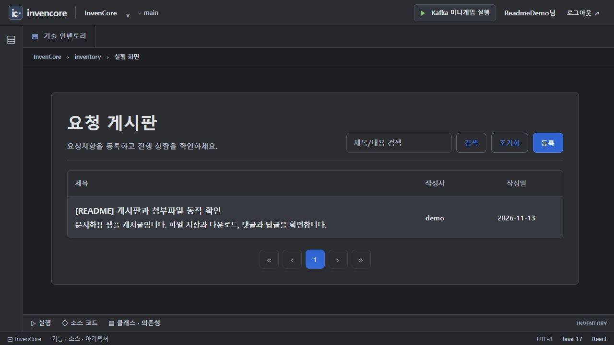
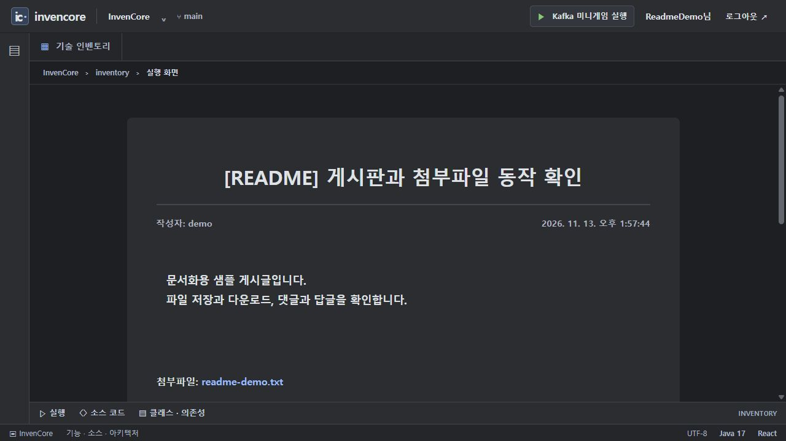

# 요청 게시판 · CRUD / 파일 첨부

카드 `board`, `files`가 공유하는 패키지입니다. 게시글 CRUD·검색·페이지 조회와 게시글당 단일 첨부파일 저장·다운로드를 제공합니다. 로그인 없이 실행하며 작성자는 `demo`입니다.

[전체 예제·실행 준비·캡처 안내](../../../../../../../../../../docs/EXAMPLES.md) · [Java 실습 안내](../../../../../../../../../../docs/INVENTORY_PRACTICE.md)

> 기준: 2026-11-13. 이미지는 별도 로컬 서버에서 샘플 데이터로 캡처했습니다. 현재 PostgreSQL 데이터는 앱 종료 후에도 유지됩니다. 이 문서의 기존 이미지는 전환 전 H2 환경에서 촬영했습니다.

## 게시판 실행

1. `/inventory/board?tab=demo` 또는 `/requestboard`에서 **글쓰기**로 이동합니다.
2. 제목·내용을 입력해 등록합니다. 제목은 최대 50자, 본문은 최대 5000자입니다.
3. 목록에서 검색어로 제목·내용을 검색하고 상세 화면에서 수정합니다.
4. 삭제는 게시글과 첨부파일 정리를 시도합니다. 댓글 연쇄 삭제는 이 서비스에서 별도로 수행하지 않습니다.



샘플 게시글 등록 후 실제 목록. 캡처 데이터는 문서용 로컬 DB에만 생성했습니다.

## 파일 첨부 실행

1. `/inventory/files?tab=demo`의 등록 폼에서 제목·본문과 첨부파일을 지정합니다.
2. 저장소의 문서용 샘플 파일을 선택해 등록하고 상세 화면에서 파일명을 확인합니다.
3. 파일명 링크로 내려받습니다. 수정 화면에서 새 파일로 교체하거나 기존 파일 제거 옵션을 선택할 수 있습니다.

[실행 캡처에 사용한 첨부 샘플](../../../../../../../../../../docs/fixtures/readme-demo.txt)



실제 Multipart 등록을 마친 게시글의 첨부파일 링크. 다운로드한 내용도 샘플 원문과 비교했습니다.

## 구조


| API | 기능 |
| --- | --- |
| `GET /api/requestboards?page=0&size=10&keyword=...` | 제목 또는 내용 검색·페이지 조회 |
| `GET /api/requestboards/{id}` | 상세 |
| `POST /api/requestboards` | Multipart 신규 등록 |
| `PUT /api/requestboards/{id}` | Multipart 수정·파일 교체·제거 |
| `DELETE /api/requestboards/{id}` | 삭제 |
| `GET /api/requestboards/download/{id}` | 게시글 ID로 첨부 다운로드 |

Multipart의 `requestBoardDTO` 파트는 `application/json`이며 `{title,content,deleteExistingFile}`를 담습니다. 선택 파트 `file`은 실제 파일입니다. `deleteExistingFile`은 수정 시 사용합니다. 일반 JSON body만 보내면 같은 요청 형식이 아닙니다.

## 주요 소스와 역할

| 소스 | 역할 |
| --- | --- |
| [RequestBoardController](controller/RequestBoardController.java) | 입력 검증, Multipart 파트, 다운로드 응답 헤더 |
| [RequestBoardServiceImpl](service/impl/RequestBoardServiceImpl.java) | CRUD, handleFileUpdate, 확장자 검사, Resource 조회 |
| [RequestBoardRepository](repository/RequestBoardRepository.java) | 제목·내용 부분 검색과 Pageable |
| [RequestBoard](entity/RequestBoard.java) | 게시글과 파일 메타데이터 |
| [RequestBoardRegist](../../../../../../../../../../frontend/src/pages/requestboard/RequestBoardRegist.jsx) | Blob JSON 파트와 파일 등록 |
| [RequestBoardEdit](../../../../../../../../../../frontend/src/pages/requestboard/RequestBoardEdit.jsx) | 기존 파일 제거·교체 |
| [RequestBoardDetail](../../../../../../../../../../frontend/src/pages/requestboard/RequestBoardDetail.jsx) | 본문·다운로드·댓글 표시 |

## 데이터·제약·실습

페이지는 0 기준이며 실제 서비스는 `createdAt DESC`로 정렬합니다. 음수 페이지는 0, 0 이하 크기는 10, 50 초과 크기는 50으로 조정합니다. `UserBoardCode`의 `id DESC`·최대 100개 독립 과제와 구분하세요. 파일은 DB BLOB이 아니라 `FILE_UPLOAD_DIR`(기본 `./uploads`)에 UUID 이름으로 저장하고 DB에는 원래 이름·저장 경로를 남깁니다. 업로드 한도는 파일·요청 각각 5MB입니다.

완성 서비스의 허용 확장자는 `.pdf,.doc,.docx,.xls,.xlsx,.ppt,.pptx,.txt,.csv,.zip,.rar,.7z,.png,.jpg,.jpeg,.gif,.bmp`입니다. `UserFilesCode`는 더 좁은 png/jpg/jpeg/pdf/txt 규칙을 사용하는 독립 과제입니다. 확장자 검사는 MIME·내용 검사나 운영 파일 보안을 완성한 것이 아닙니다.

디스크 작업과 DB 트랜잭션은 하나의 원자적 트랜잭션이 아닙니다. H2 재시작 시 파일 메타데이터가 사라지므로 디스크 파일만 남겨도 다운로드가 유지되는 것은 아닙니다. 공개 CRUD 예제이므로 실서비스의 작성자 권한·첨부 접근 통제는 별도로 설계해야 합니다.

[페이지 과제](../practice/UserBoardCode.java) · [첨부 정책 과제](../practice/UserFilesCode.java)

```powershell

# 저장소 루트에서 실행
.\backend\gradlew.bat -p backend test --tests "*RequestBoardAuthenticationTests"
```

## 사용하는 기술

Spring MVC/Multipart · Spring Data JPA · Bean Validation · Java NIO · Lombok. 정확한 버전과 의존성 선언은 저장소의 `backend/build.gradle`에서 확인합니다.
