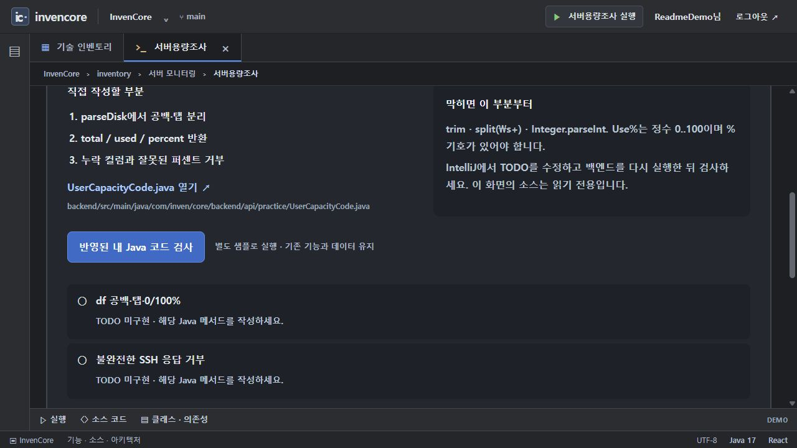
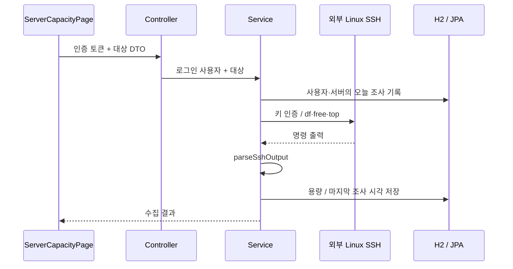

# 서버용량조사 · 선택적 SSH 예제

카드 `capacity`의 백엔드 패키지입니다. Apache SSHD로 Linux 서버에서 디스크·메모리·CPU 정보를 수집합니다. 현재 기본 설정은 비활성화이며 외부 서버 접속정보나 개인키를 제공하지 않습니다.

[전체 예제·실행 준비·캡처 안내](../../../../../../../../../../docs/EXAMPLES.md) · [Java 실습 안내](../../../../../../../../../../docs/INVENTORY_PRACTICE.md)

> 기준: 2026-11-13. 이미지는 별도 로컬 서버에서 샘플 데이터로 캡처했습니다. 기본 H2 메모리 데이터는 서버 종료 시 사라집니다.

## 현재 실행 범위

`/inventory/capacity?tab=demo`에서 노트·소스·독립 Java 과제를 볼 수 있습니다. 실제 수집은 로그인, `FEATURE_SERVER_CAPACITY_ENABLED=true`, 외부 SSH 키와 대상 서버 설정이 있어야 합니다. 이 문서화 작업에서는 원격 서버에 접속하지 않았고 수집 성공 화면을 만들어 넣지 않았습니다.



현재 기본 환경의 서버용량조사 카드와 Java 파싱 과제 검사. 실제 SSH 수집 결과가 아닙니다.

## 처리 구조



| 항목 | 설정 / 구현 |
| --- | --- |
| 기능 등록 | `FEATURE_SERVER_CAPACITY_ENABLED=true`일 때 컨트롤러·서비스 등록 |
| 키 파일 | `SSH_PEM_FILE`로 지정한 저장소 밖의 파일. 앱에 포함하지 않음 |
| 서버 목록 | `MONITORED_SERVERS`의 `serverNo,serverType,host,port,user` 형식, 여러 서버는 `;`로 구분 |
| 명령 | `df -h /`, `free -m`, `top -bn1`의 Linux 출력 |
| 시간 제한 | SSH 연결·인증·채널 작업에 10초 기준 |
| 조사 제한 | 로그인 사용자·서버별 하루 한 번. 제한은 HTTP 429 |

## API와 소스

`GET /api/server-capacity/servers`는 설정한 대상 목록, `GET /api/server-capacity`는 저장된 최근 결과, `POST /api/server-capacity/check`는 대상 DTO의 수집 요청입니다. 기능이 꺼져 있으면 해당 API가 등록되지 않으며 보호 경로 인증도 별도 적용됩니다.

## 주요 소스와 역할

| 소스 | 역할 |
| --- | --- |
| [ServerCapacityController](controller/ServerCapacityController.java) | 설정 목록, Principal 전달, 제한·실패 응답 |
| [ServerCapacityServiceImpl](service/impl/ServerCapacityServiceImpl.java) | 일일 제한·키 로딩·SSH·출력 파싱·저장 |
| [ServerCapacity](entity/ServerCapacity.java) | 서버별 수집 값 |
| [ServerCapacityCheckLog](entity/ServerCapacityCheckLog.java) | 사용자·서버별 마지막 조사 시각 |
| [ServerCapacityPage](../../../../../../../../../../frontend/src/pages/servercapacity/ServerCapacityPage.jsx) | 목록·수집 버튼·결과 화면 |
| [UserCapacityCode.parseDisk](../practice/UserCapacityCode.java) | 외부 접속 없는 df 한 줄 파싱 과제 |

## 제한과 검사

현재 CPU 수치는 `top`의 `us` 값을 사용하며 전체 CPU 사용률과 동일한 정의가 아닙니다. 출력 형식·언어·OS에 따라 파싱을 재검토해야 합니다. 요청 DTO의 host·port·user를 사용하므로 운영에서는 서버 측 대상 허용 목록 검증이 필요합니다. 기존 접속 주소·개인키·오래된 배포 설정을 복원해 사용하지 마세요.

독립 파싱 과제는 로그인이나 SSH 없이 실행할 수 있습니다. 미작성 상태에서는 의도적으로 TODO 미구현 결과가 표시됩니다.

```powershell

# 저장소 루트에서 실행
.\backend\gradlew.bat -p backend test --tests "*ServerCapacityKeyConfigurationTests"
```

## 사용하는 기술

Apache SSHD · Spring Data JPA · Spring MVC/Security · Java NIO. 정확한 버전과 의존성 선언은 저장소의 `backend/build.gradle`에서 확인합니다.
