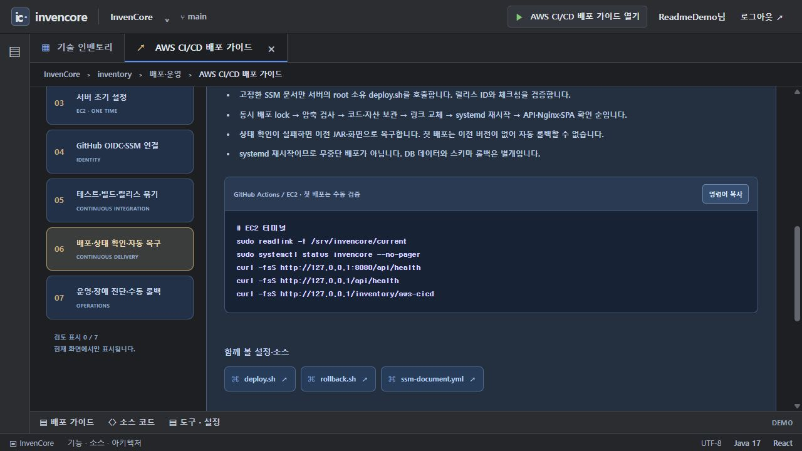
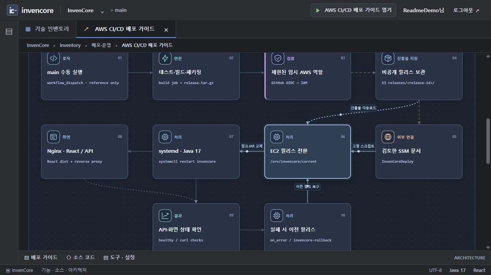

# AWS 배포 참고 템플릿

이 디렉터리의 파일은 자동 실행되지 않습니다. 현재 AWS 연결·권한·배포를 완료했다는 의미가 아닙니다.

전체 절차: [AWS CI/CD 가이드](../docs/AWS_CICD.md). 사이트에서는 **AWS CI/CD 배포 가이드** 카드에서 단계별 명령어·구조도·소스를 볼 수 있습니다.

- `ci-cd.yml`: 나중에 검토 후 `.github/workflows/`로 복사할 GitHub Actions 템플릿
- `package-release.sh`: React dist + Spring Boot JAR를 같은 릴리스로 묶음
- `ssm-document.yml`: 검토한 서버 배포 스크립트만 호출하는 SSM Command 문서
- `bootstrap.sh`: 새 전용 Amazon Linux 2023 인스턴스 초기 설정. 기존 서버에는 그대로 실행하지 않음
- `deploy.sh`, `rollback.sh`: 릴리스 전환·상태 확인·이전 릴리스 복구
- `nginx.conf`, `invencore.conf`: 정적 화면·SPA fallback·API reverse proxy
- `invencore.service`, `application.env.example`: systemd 서비스와 비밀값 없는 환경 예시
- `github-trust.json`, `github-policy.json`: GitHub OIDC 배포 역할
- `ec2-trust.json`, `ec2-artifact-policy.json`: EC2 역할과 산출물 읽기 정책

실제 환경 파일·개인키·접속 주소·AWS 자격증명은 이 디렉터리에 저장하지 않습니다. 예시 JSON의 자리표시자를 실제 값으로 치환한 사본은 저장소 밖에서 관리하세요.

## 인벤토리에서 확인하기

`/inventory/aws-cicd?tab=demo`에서 7개 준비 단계를 선택하고 명령어·관련 파일·검토 표시를 확인합니다. `아키텍처` 탭에서는 GitHub Actions → OIDC → S3 → SSM → EC2 → 상태 확인·코드 롤백의 역할과 연결을 볼 수 있습니다. 단계 선택과 복사는 로컬 화면 기능이며 명령을 실행하지 않습니다.

2026-11-13 실제 가이드 화면입니다. AWS 리소스를 생성하거나 배포를 수행한 결과가 아닙니다.

구조도의 흐름 강조는 설명용이며 실시간 서버 상태를 표시하지 않습니다. 실제 적용 전에는 전체 가이드의 OS·권한·네트워크·HTTPS·데이터 보존 조건을 검토합니다.

[전체 예제·패키지 README 인덱스](../docs/EXAMPLES.md) · [촬영 환경과 이미지 목록](../docs/screenshots/README.md)
