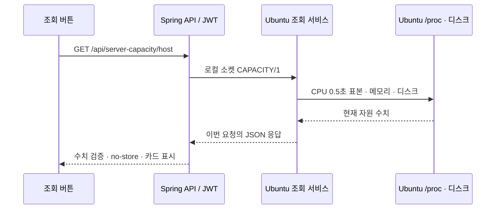

# Ubuntu 요청 시 직접 용량 조회

2026-11-14 기준. **지금 조회 → JWT API → Ubuntu 로컬 소켓 → 해당 요청에서 새로 측정 → 응답** 구조입니다. 결과 JSON 파일, 주기 수집 타이머, 자동 조회는 사용하지 않습니다.



## 측정과 접근 범위

- Hyper-V **Ubuntu VM 전체** 기준입니다. Windows 전체나 백엔드 컨테이너의 768MB 제한이 아닙니다.
- CPU는 `/proc/stat` 0.5초 차이로 비유휴 비율을 계산합니다. idle+iowait는 유휴로 처리하고 guest를 중복 합산하지 않으며 steal은 비유휴에 포함합니다.
- 메모리는 `MemTotal - MemAvailable`입니다. 회수 가능한 캐시를 반영합니다.
- 디스크는 Ubuntu `/` 파일시스템입니다. 다른 마운트는 제외합니다. 예약 공간 때문에 일반 사용자 사용 가능+사용이 전체보다 작을 수 있습니다.
- GiB는 1024³ 바이트입니다. UTC 측정 시각은 브라우저 현지 시각으로 표시합니다.
- 서버 요청은 연결·쓰기·읽기 합계 5초, 응답 최대 8KiB입니다. 동시 호스트 측정은 최대 4개이고 초과 시 BUSY/429를 반환합니다.
- 일반 전용 계정으로 실행합니다. 셸 실행·임의 명령·URL·대상 경로 입력은 받지 않습니다. IP·키·계정·프로세스 목록은 응답하지 않습니다.
- 외부 TCP 포트를 열지 않습니다. 소켓 디렉터리만 읽기 전용 마운트하며 호스트 루트·Docker 소켓은 공유하지 않습니다.
- 소켓은 로컬 사용자도 `/proc`와 같은 집계 정보를 조회할 수 있도록 0666입니다. 쓰기 권한은 고정 조회 프로토콜 연결용이며 파일 쓰기나 호스트 제어 권한이 아닙니다. 웹 접근은 기존 JWT 인증을 유지합니다.

## 1. Ubuntu 조회 서비스 설치/이전 타이머 전환

수정 소스를 서버에 반영한 뒤 **Ubuntu에서** 실행합니다. `git pull`이 미추적 Compose 파일 충돌 등으로 실패하면 파일을 백업해 해결하고, 이후 설치를 진행하세요.

```bash
(
  set -e
  cd /opt/homeserver/apps/InvenCore
  git pull --ff-only
  sudo bash deployment/monitoring/install-host-query.sh
  python3 deployment/monitoring/query-host-capacity.py
)
```

설치 스크립트는 전용 계정·Python 서비스·systemd unit을 설치하고, 이전 metrics timer가 있으면 중지·비활성화합니다. 새 서비스가 실제로 응답하는지 확인합니다. **앱 컨테이너·DB·볼륨·기존 `.env.docker`는 변경하지 않습니다.** 실패하면 후속 단계로 넘어가지 않습니다.

서비스는 `/run/invencore-host/capacity.sock`에서 요청을 기다리기만 하며, 요청을 받기 전에는 측정하지 않습니다. 서비스 재시작 시에도 디렉터리를 유지해 컨테이너의 디렉터리 마운트가 끊기지 않도록 합니다. 과거 `/var/lib/invencore-host-capacity/capacity.json`이 남아 있어도 읽지 않으며 자동으로 삭제하지 않습니다.

## 2. 앱 연결

`compose.monitoring.yml`을 추가해야 합니다. 이전 결과 파일 마운트 대신 **호스트 `/run/invencore-host` → 컨테이너 `/run/invencore-host`**를 연결합니다. 최신 코드 이미지와 overlay를 같이 적용해야 하며 이전 이미지에 설정만 붙여서는 동작하지 않습니다.

현재 운영 DB를 먼저 확인하세요. H2 메모리로 실행 중이면 백엔드를 재생성·재시작할 때 회원·게시글이 사라집니다. 영속 DB와 데이터 이관 여부를 확인하기 전에는 아래 `up`을 실행하지 않습니다. PostgreSQL이라면 기존 접속 환경변수·네트워크를 유지하며, 별도 DB 컨테이너나 볼륨을 삭제하지 않습니다.

새 코드가 GHCR에 게시된 성공한 commit SHA를 사용합니다. 이 문서 작성 작업은 원격 배포를 수행하지 않았습니다.

```bash
cd /opt/homeserver/apps/InvenCore
release=REPLACE_WITH_SUCCESSFUL_40_CHARACTER_COMMIT_SHA
mon() {
  sudo env APP_IMAGE_TAG="$release" docker compose --env-file .env.docker \
    -p invencore-app -f compose.app.yml -f compose.ghcr.yml \
    -f compose.monitoring.yml "$@"
}
mon config --quiet
mon pull

# 기존 DB 보존과 현재 배포 설정을 확인한 뒤에만 실행
mon up -d --no-build --pull never backend frontend
```

기존 `.env.docker`의 JWT·CORS·DB 설정은 그대로 사용합니다. `HOST_CAPACITY_SOCKET`은 overlay가 지정하므로 새 키나 비밀번호를 만들 필요가 없습니다. `docker compose down -v`는 사용하지 않습니다. 다른 앱 배포 overlay가 있다면 함께 유지하세요.

## 3. 확인

```bash
systemctl status invencore-host-capacity.service --no-pager
journalctl -u invencore-host-capacity.service -n 20 --no-pager
python3 deployment/monitoring/query-host-capacity.py

sudo docker inspect invencore-app-backend-1 \
  --format '{{range .Mounts}}{{println .Source "->" .Destination "RW=" .RW}}{{end}}'
sudo docker exec invencore-app-backend-1 test -S /run/invencore-host/capacity.sock
```

소켓은 텍스트 파일이 아니므로 `cat`으로 읽지 않습니다. 위 Python 도구가 매번 실제 질의합니다. 브라우저에 로그인하고 `/inventory/capacity?tab=demo`에서 **지금 조회**를 누르세요. 버튼을 누르기 전에는 측정되지 않고, 두 번 누르면 측정 시각이 달라져야 합니다.

- 401: 로그인 필요.
- 503: 조회 서비스·소켓 마운트·응답 형식·시각 확인. 이전 파일로 대체하지 않습니다.
- 429: 동시 측정 중. 잠시 후 재시도.
- Docker permission denied: `sudo docker`로 점검합니다. Docker 소켓 권한을 완화하지 않습니다.

## 테스트

- Python 7개: CPU/메모리 계산, 요청이 없으면 측정 안 함, 매번 새 측정, 잘못된 명령·실패·과부하 처리.
- `HostCapacityTests`: 직접 호출 반복·응답 검증·503/429.
- `HostCapacityClientTests`: 실제 Unix 소켓 프로토콜·크기 제한·무응답 시간 제한. 미지원 OS는 해당 테스트만 건너뜁니다.
- CI: 호스트 측 조회 서비스를 임시 실행하고, 비특권 앱 컨테이너에서 읽기 전용 소켓 마운트로 접근합니다. Nginx/JWT를 거친 두 조회의 측정 시각이 각각 요청 이후이며 증가하는지 검사합니다.

참고: [Java 17 UnixDomainSocketAddress](https://docs.oracle.com/en/java/javase/17/docs/api/java.base/java/net/UnixDomainSocketAddress.html), [Python socketserver](https://docs.python.org/3.12/library/socketserver.html), [systemd 실행 환경](https://www.freedesktop.org/software/systemd/man/latest/systemd.exec.html).
