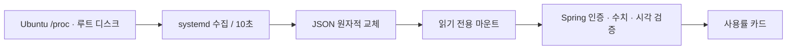

# Ubuntu 호스트 용량 조사

기준: 2026-11-14. Hyper-V **Ubuntu VM 전체**를 측정합니다. Windows 호스트 전체나 Docker 개별 컨테이너 한도가 아닙니다.



## 측정 기준

| 항목 | 기준 |
| --- | --- |
| CPU | `/proc/stat`의 0.5초 차이. `100 × (total-idle-iowait) / total`. guest/guest_nice는 중복 합산하지 않음. VM steal 시간은 비유휴에 포함 |
| 메모리 | `/proc/meminfo`의 `MemTotal - MemAvailable`. 회수 가능한 캐시를 사용 가능량에 반영 |
| 디스크 | Ubuntu `/` 파일시스템의 전체·사용·일반 사용자 사용 가능 바이트. 별도 마운트 제외. 예약 블록으로 사용+사용 가능이 전체보다 작을 수 있음 |
| 단위 | GiB = 1024³ 바이트, 사용률 = % |
| 시각 | UTC 수집 시각. 화면은 현지 시각 표시. 30초 초과 또는 5초 초과 미래 결과는 503 |

CPU 계수 감소·CPU 수 변경·수집 오류 시 기존 파일을 덮어쓰지 않습니다. 다음 수집에서 재시도하고, API는 오래된 파일을 거부합니다. JSON에는 IP·접속 계정·키·프로세스 목록이 없습니다.

## 1. Ubuntu 수집기 설치

최신 소스를 서버에 가져온 뒤 **Ubuntu에서** 실행합니다. 현재 작업에서는 원격 서버에 실행하지 않았습니다. 수집기 설치는 기존 앱 컨테이너·H2·PostgreSQL을 변경하지 않습니다.

```bash
cd /opt/homeserver/apps/InvenCore
getent passwd invencore-monitor >/dev/null || \
  sudo useradd --system --user-group --home-dir /nonexistent \
    --shell /usr/sbin/nologin invencore-monitor

sudo install -d -m 0755 /usr/local/lib/invencore-monitor
sudo install -m 0644 deployment/monitoring/collect-host-capacity.py \
  /usr/local/lib/invencore-monitor/collect-host-capacity.py
sudo install -m 0644 deployment/monitoring/invencore-host-capacity.service \
  /etc/systemd/system/invencore-host-capacity.service
sudo install -m 0644 deployment/monitoring/invencore-host-capacity.timer \
  /etc/systemd/system/invencore-host-capacity.timer

sudo systemctl daemon-reload
sudo systemctl start invencore-host-capacity.service
sudo systemctl enable --now invencore-host-capacity.timer
systemctl list-timers invencore-host-capacity.timer
python3 -m json.tool /var/lib/invencore-host-capacity/capacity.json
```

집계 파일에 인증정보는 없습니다. 전용 계정으로 실행하고 `ProtectSystem=strict`·`ProtectHome`·권한 제한을 적용합니다. 스크립트를 수정했다면 `/usr/local/lib`의 설치본도 갱신합니다.

## 2. Compose로 읽기 전용 연결

`compose.monitoring.yml`은 선택적 overlay입니다. 수집 디렉터리만 공유하며 Docker 소켓·호스트 루트·SSH 키는 마운트하지 않습니다. **단일 파일 대신 디렉터리를 마운트**하므로 원자적 교체 후에도 새 파일을 읽습니다. 디렉터리가 없으면 임의로 만들지 않고 실패합니다.

기존 `.env.docker`를 유지합니다. overlay가 기능 활성화와 host 모드·파일 경로만 지정합니다. 기본 앱 설정도 host 모드이며, 수집기가 없으면 503을 표시합니다.

**기존 H2 백엔드를 재생성하면 데이터가 초기화됩니다.** 데이터 이관 여부를 검토하기 전에는 기존 `invencore-app`에 바로 `up`을 실행하지 않습니다. 아래는 별도 후보 앱입니다. 포트·메모리 여유를 먼저 확인하고, 새 코드가 GHCR에 게시된 SHA를 사용합니다.

```bash
release=REPLACE_WITH_SUCCESSFUL_40_CHARACTER_COMMIT_SHA
candidate() {
  APP_IMAGE_TAG="$release" FRONTEND_PORT=8083 docker compose --env-file .env.docker \
    -p invencore-host-check -f compose.app.yml -f compose.ghcr.yml \
    -f compose.monitoring.yml "$@"
}
candidate config --quiet
candidate pull
candidate up -d --no-build --pull never
candidate ps
```

후보 앱은 빈 H2 DB입니다. SSH 터널로 8083에 접속한 뒤 신규 가입·로그인을 하고 `/inventory/capacity?tab=demo` 또는 `/servercapacity`에서 확인합니다. 기존 Funnel/8082 서비스는 그대로입니다. 현재 이미지에는 이 코드가 없으므로 빌드·게시 후 적용해야 합니다.

정식 전환과 HTTPS 검증은 [안전 배포 안내](../docker/HTTPS_FUNNEL.md)를 따르되 모든 Compose 명령에 `-f compose.monitoring.yml`을 포함합니다. PostgreSQL·기존 테스트 컨테이너·볼륨을 삭제하지 않습니다.

로컬 실행에서 Ubuntu 수집 파일을 별도로 가져왔다면 `HOST_CAPACITY_FILE`로 경로를 지정할 수 있습니다. Windows 자체 메트릭이나 테스트 수치로 대체하지 않습니다.

## 3. 상태·오류 확인

- 인증 없음: 401. 기존 JWT 필터·권한 유지.
- 정상 수집: 200 + `Cache-Control: no-store`.
- 파일 누락·형식 오류·수집 중단: 503과 설명 메시지.
- 기능 명시적 비활성화: API 미등록.
- 기존 SSH 모드: `SERVER_CAPACITY_MODE=ssh`와 서버·키 설정 필요. 이전 `/servers`, `/check`, JPA 기능용이며 새 화면과 다릅니다.

```bash
systemctl status invencore-host-capacity.timer --no-pager
journalctl -u invencore-host-capacity.service -n 30 --no-pager
free -b
df -B1 /
```

`sudo systemctl stop invencore-host-capacity.timer`로 수집을 중지하면 약 30초 후 조회 시 수집 중단을 감지합니다. 예약 공간 계산 차이가 있으므로 `df`와 비교할 때는 바이트 값을 확인합니다.

## 검증

`python3 -m unittest discover -s deployment/monitoring -p 'test_*.py' -v`와 백엔드 `HostCapacityTests`, `HostCapacityApiTests`가 계산·파일 교체·손상/오래된 파일 거부·인증을 검사합니다. 실제 Ubuntu systemd와 실측값은 설치 후 확인해야 합니다.

근거: [Linux /proc](https://docs.kernel.org/filesystems/proc.html), [systemd 실행 환경](https://www.freedesktop.org/software/systemd/man/latest/systemd.exec.html).
