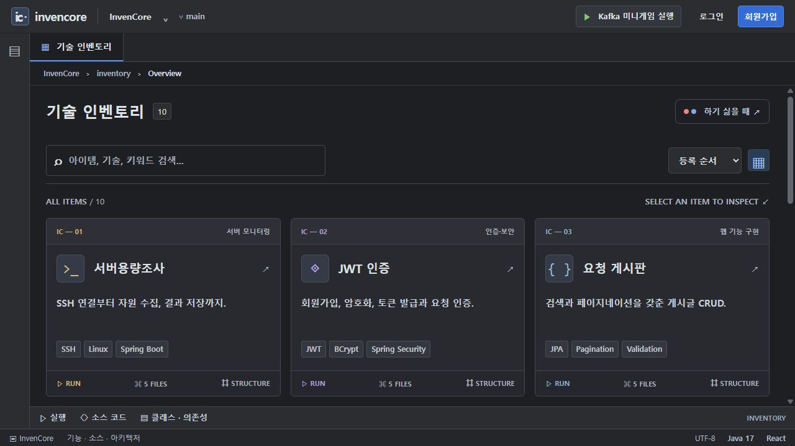

# 기술 인벤토리 · 패키지별 예제와 실행 이미지

현재 인벤토리 카드 **10개**를 기능 패키지 README로 연결했습니다. 실행 방법, 처리 흐름, 주요 클래스·메서드, API, 데이터 저장 방식, 직접 구현 과제와 현재 한계를 함께 확인할 수 있습니다.



## 예제 찾아보기

같은 코드를 공유하는 카드는 한 패키지 README 안에서 구분합니다. DTO·Repository·Service 하위 폴더마다 설명을 복제하지 않고 기능 패키지 루트에서 소스로 연결합니다.

| 카드 | 백엔드·설정 패키지 README | 프론트엔드 패키지 README | 실제 화면 / 확인 범위 |
| --- | --- | --- | --- |
| 서버용량조사 | [serverCapacity](../backend/src/main/java/com/inven/core/backend/api/serverCapacity/README.md) | [servercapacity](../frontend/src/pages/servercapacity/README.md) | [파싱 과제 검사](screenshots/capacity-practice.jpg). SSH는 기본 비활성, 실제 원격 수집 안 함 |
| JWT 인증 | [member](../backend/src/main/java/com/inven/core/backend/api/member/README.md) | [auth](../frontend/src/pages/auth/README.md) | [회원가입](screenshots/auth-registered.jpg) · [로그인](screenshots/auth-logged-in.jpg) |
| 요청 게시판 | [requestboard · CRUD](../backend/src/main/java/com/inven/core/backend/api/requestboard/README.md) | [requestboard](../frontend/src/pages/requestboard/README.md) | [실제 등록 후 목록](screenshots/board-list.jpg) |
| 파일 첨부 | [requestboard · Multipart](../backend/src/main/java/com/inven/core/backend/api/requestboard/README.md) | [requestboard](../frontend/src/pages/requestboard/README.md) | [첨부 링크](screenshots/files-attached.jpg), 실제 다운로드 원문 일치 확인 |
| 댓글과 답글 | [comment](../backend/src/main/java/com/inven/core/backend/api/comment/README.md) | [requestboard](../frontend/src/pages/requestboard/README.md) | [부모 댓글·직계 답글](screenshots/comments-thread.jpg) |
| 병렬 스트림 | [benchmark · streams](../backend/src/main/java/com/inven/core/backend/api/benchmark/README.md) | [benchmark](../frontend/src/pages/benchmark/README.md) | [실제 CPU 연산 비교](screenshots/parallel-stream-result.jpg) |
| 인덱스 튜닝 | [benchmark · indexes](../backend/src/main/java/com/inven/core/backend/api/benchmark/README.md) | [benchmark](../frontend/src/pages/benchmark/README.md) | [실제 H2 조회 비교](screenshots/index-tuning-result.jpg) |
| GW 데이터 연동 | [gwsync](../backend/src/main/java/com/inven/core/backend/api/gwsync/README.md) | [gwsync](../frontend/src/pages/gwsync/README.md) | [생성 v1](screenshots/gw-sync-created.jpg) · [수정 v2](screenshots/gw-sync-updated.jpg). local 내부 이벤트·메모리 캐시 |
| Kafka 미니게임 | [orderlab](../backend/src/main/java/com/inven/core/backend/api/orderlab/README.md) | [gwsync](../frontend/src/pages/gwsync/README.md) | [순서](screenshots/kafka-order-complete.jpg) · [대기열](screenshots/kafka-paused-backlog.jpg) · [재처리](screenshots/kafka-replay-result.jpg). local 학습 모형 |
| AWS CI/CD 가이드 | [deployment](../deployment/README.md) | [공통 인벤토리](../frontend/src/components/inventory/README.md) | [단계별 가이드](screenshots/aws-cicd-guide.jpg) · [참고 구조도](screenshots/aws-cicd-architecture.jpg). 실제 AWS 배포 안 함 |

공통 구현은 [백엔드 패키지 안내](../backend/README.md), [인벤토리 공통 컴포넌트](../frontend/src/components/inventory/README.md), [독립 Java 과제](../backend/src/main/java/com/inven/core/backend/api/practice/README.md), [게임에 적용하는 Kafka 과제](../backend/src/main/java/com/inven/core/backend/api/orderlab/practice/README.md)에서 확인합니다.

## 먼저 실행하기

JDK 17과 Node.js·npm이 필요합니다. 명령은 저장소 루트를 기준으로 합니다.

터미널 1:

```powershell
.\backend\gradlew.bat -p backend bootRun
```

터미널 2:

```powershell
cd frontend
npm ci
npm start -- --port 5174 --strictPort
```

`http://localhost:5174`를 열어 카드를 선택하고 **실행** 탭으로 이동합니다. 프론트의 `/api` 요청은 기본 `localhost:8080`으로 프록시합니다. 포트가 사용 중이면 기존 프로세스의 용도를 확인하고, 아래처럼 다른 포트의 별도 서버를 사용할 수 있습니다.

## 캡처와 같은 분리 환경으로 재현하기

문서화 시에는 이미 실행 중인 개발 서버와 구분하려고 백엔드 `18080`, 프론트 `5175`를 사용했습니다. 앱 소스나 기본 설정 파일은 바꾸지 않았습니다.

터미널 1:

```powershell
$env:FILE_UPLOAD_DIR = Join-Path $env:TEMP 'invencore-readme-demo-uploads'
.\backend\gradlew.bat -p backend bootRun --args='--server.address=127.0.0.1 --server.port=18080 --app.cors.allowed-origins=http://localhost:5175,http://127.0.0.1:5175'
```

터미널 2:

```powershell
cd frontend
node --input-type=module -e 'import {createServer} from "vite"; const server=await createServer({server:{host:"127.0.0.1",port:5175,strictPort:true,proxy:{"/api":{target:"http://127.0.0.1:18080",changeOrigin:true}}}}); await server.listen(); server.printUrls();'
```

새 터미널을 사용하고 문서 촬영 후 프로세스를 종료합니다. 첨부파일은 위 임시 디렉터리에 남을 수 있지만, H2 메타데이터는 서버 종료 시 사라집니다. 재시작하면 회원·게시글·연동·게임 실행을 다시 생성해야 합니다. 업로드 원문은 [문서용 샘플 파일](fixtures/readme-demo.txt)을 사용할 수 있습니다.

## 이미지가 보여주는 것

- 촬영일: **2026-11-13**, 프로젝트의 실제 화면을 JPEG로 저장했습니다. 목업·합성 성과 화면이 아닙니다.
- Kafka·GW는 기본 `local` 모드입니다. 외부 Kafka·Redis의 연결·처리 성능을 확인한 이미지가 아닙니다.
- 성능 예제는 기본 30만 행, Java 17, H2 환경에서 버튼으로 실행했습니다. 캡처의 배율과 시간은 해당 실행의 관측값이며 보장된 성과가 아닙니다.
- 회원·게시글·댓글은 문서용 합성 데이터입니다. 비밀번호·토큰 원문·실제 SSH 주소·키를 이미지에 담지 않았습니다.
- 서버용량조사는 외부 접속을 수행하지 않았습니다. TODO 검사 실패는 미구현 과제의 상태이며 수집 성공을 뜻하지 않습니다.
- AWS는 참고 가이드와 설명용 구조도를 촬영했습니다. 계정 연결·권한 생성·실제 배포·롤백은 수행하지 않았습니다.
- 이미지의 측정값·시각·ID는 고정 스냅샷입니다. 서버를 다시 실행하면 동일하게 나올 필요는 없습니다.

전체 이미지 목록과 촬영 범위는 [캡처 목록](screenshots/README.md), 원본 경로와 모드는 [captures.json](screenshots/captures.json)에 기록했습니다.

## 문서와 캡처 갱신

1. 기능을 수정하면 해당 패키지 README의 실행 순서·API·제약을 먼저 맞춥니다.
2. 실행 모드를 확인하고 샘플 데이터로 실제 동작을 재현합니다. 결과가 표시되기 전에 캡처하지 않습니다.
3. `docs/screenshots/`의 해당 이미지를 갱신하고 날짜·모드·설명을 함께 수정합니다. 토큰과 비밀값이 보이는 화면은 저장하지 않습니다.
4. 이 인덱스와 프론트엔드의 연결 문서도 확인합니다. 새 기능 카드는 README와 실행 이미지 연결을 함께 추가합니다.

실습 TODO는 [전체 Java 과제 안내](INVENTORY_PRACTICE.md)를 참고합니다. 9개 구현형 카드에 과제가 있으며 AWS 참고 카드는 배포 가이드입니다.
