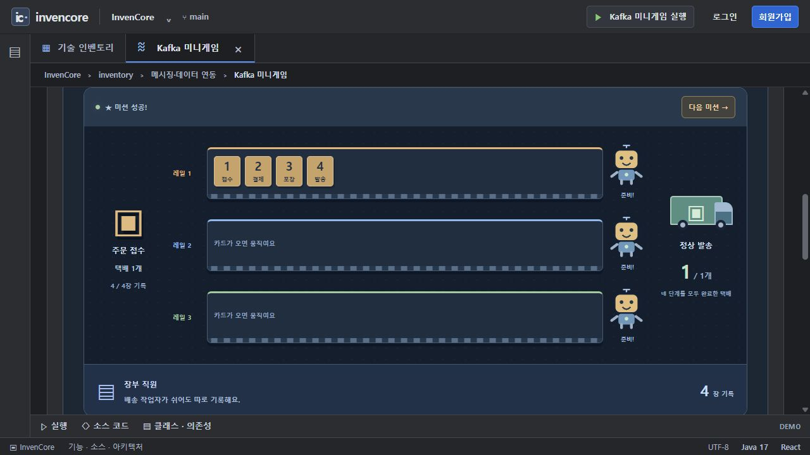

# 인벤토리 공통 컴포넌트

10개 카드의 노트·실행·소스·아키텍처·구현 참조를 구성합니다. 예제별 설명은 기능 패키지 README에서 확인합니다.

[전체 예제·실행 준비·캡처 안내](../../../../docs/EXAMPLES.md) · [Java 실습 안내](../../../../docs/INVENTORY_PRACTICE.md)

> 기준: 2026-11-13. 이미지는 별도 로컬 서버에서 샘플 데이터로 캡처했습니다. 기본 H2 메모리 데이터는 서버 종료 시 사라집니다.

| 컴포넌트 | 역할 |
| --- | --- |
| `ImplementationNotes` | 기능 요약·실행 흐름·제한 |
| `FeatureDemo` | 카드별 실행 또는 배포 가이드 선택 |
| `SourceViewer` | 허용된 실제 소스·줄 번호·주석 강조·복사 |
| `ArchitectureView` | 도형·연결·단계 재생·소스 링크. 설명용 애니메이션 |
| `ImplementationReference` | 클래스·메서드·관련 의존성. 소스의 Javadoc 우선 |
| `JavaPracticePanel` | Kafka 외 8개 Java 과제 검사 |
| `KafkaPracticePanel` / `ParcelFactoryGame` | Kafka TODO·용어와 세 미션 |
| `DeploymentGuide` | 단계별 AWS 명령어와 설정 참조. 명령 실행 기능 아님 |
| `BreakRoomDialog` / `SourceDeletionScene` | 카드 실습과 별개인 휴식 팝업·가상 삭제 연출 |

카드 정의는 `src/data/inventory.js`, 구조도는 `src/data/architectures.js`에 있습니다. 백엔드 파일은 `frontend/config/inventorySourcePlugin.js`의 허용 목록만 공개합니다. 실제 환경 파일·키·인증정보를 공개 목록에 넣지 않습니다.

## 실제 실행 예시



공통 카드 실행 탭 안에서 동작하는 Kafka 미니게임.

## 검사

```powershell
cd frontend
npm run lint
npm test
npm run build
```

새 카드를 추가하면 기능 패키지 README·전체 예제 인덱스·화면 캡처도 함께 갱신합니다. 휴식 연출은 실제 소스 삭제 API를 사용하지 않으며 음원·자동 재생 여부는 브라우저 정책과 로컬 자산에 따릅니다.
