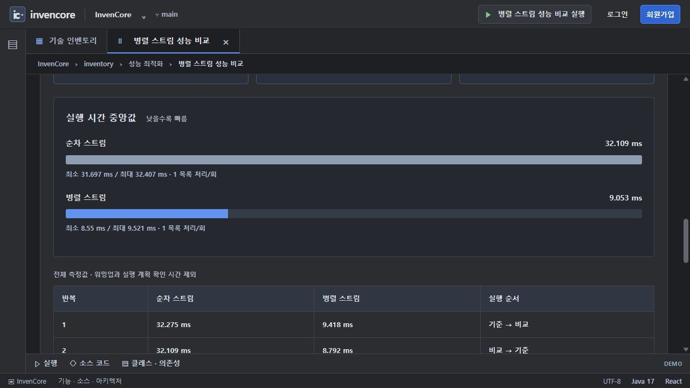

# 성능 비교 화면

기능별 화면 컴포넌트 패키지입니다. 업무 규칙·API·실행 조건은 아래 백엔드 패키지 README를 기준으로 확인합니다.

[전체 예제·실행 준비·캡처 안내](../../../../docs/EXAMPLES.md) · [Java 실습 안내](../../../../docs/INVENTORY_PRACTICE.md)

> 기준: 2026-11-13. 이미지는 별도 로컬 서버에서 샘플 데이터로 캡처했습니다. 기본 H2 메모리 데이터는 서버 종료 시 사라집니다.

## 연결된 기능 문서

- [두 카드의 백엔드·측정 조건](../../../../backend/src/main/java/com/inven/core/backend/api/benchmark/README.md)

## 주요 소스와 역할

| 소스 | 역할 |
| --- | --- |
| [BenchmarkPage.jsx](BenchmarkPage.jsx) | kind별 비교 요청, 표본·중앙값·실행 계획 표시 |

## 실행 화면

같은 기능의 실제 로컬 실행 화면. 재현 순서와 캡처 범위는 연결된 기능 문서에 기록했습니다.

## 화면 연결 시 주의

API는 공통 Axios의 `/api` 상대 경로를 사용합니다. 개발 서버는 이를 백엔드로 프록시합니다. 요청 처리·취소·주기 조회를 바꿀 때는 중복 요청과 언마운트 이후 상태 변경을 함께 확인합니다. 화면의 직접 구현 과제와 완성 서비스의 실행은 별도 기능입니다.
